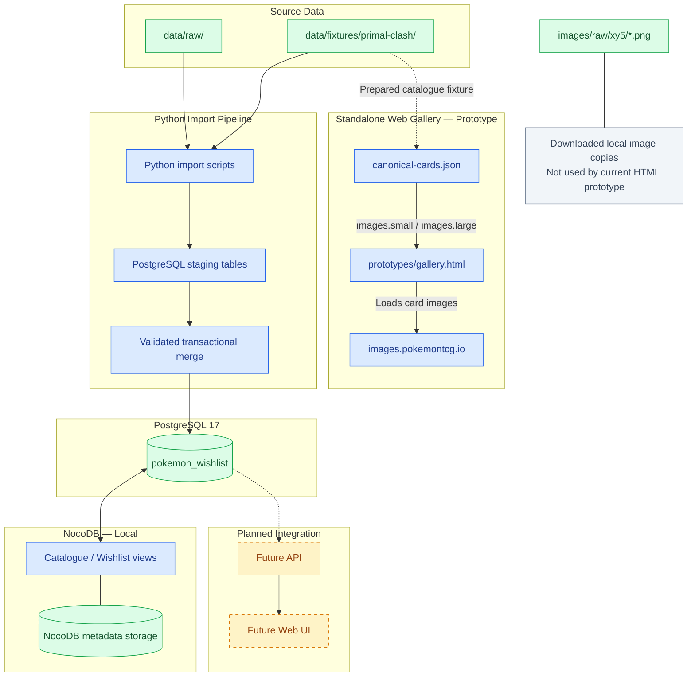

# Pokemon Card Wishlist — Project Structure and Local Workflow

**Status:** Working reference guide  
**Updated:** 2026-11-08  
**Environment covered:** Local Windows development only; Raspberry Pi deployment is not covered  
**Repository:** <https://github.com/northproxy/pokemon-card-wishlist>

## Purpose and how to use this guide

This guide explains **what lives where**, **how the parts connect**, **how to open and run each component**, and **what belongs in GitHub**. It is intended as a practical starting point when returning to the project after a break.

The directory inventory is based on the local `tree.txt` supplied on 2026-11-08, and Git exclusions are based on the supplied `.gitignore`. Runtime details and validation results are based on the project work completed so far. A file's presence in the local tree **does not prove it has been committed or pushed to GitHub**.

Start here after a break: [Quick start](#quick-start-next-session), then [Where things live](#where-things-live), then [How the components connect](#how-the-components-connect).

## Current project state

| Area | Current status | Notes |
| --- | --- | --- |
| M0 — Discovery | Completed | Primal Clash is the first expansion. |
| M1 — Repository foundation | Completed | GitHub repository, documentation, issue templates, and Markdown checks. |
| M2 — Infrastructure | In progress | Local Windows environment only; Raspberry Pi work is deferred. |
| M3 — Data model | Completed and locally validated | PostgreSQL schema managed by 17 `dbmate` migrations. |
| M4 — First import | Completed and validated | Canonical-card and market-data vertical slice. |
| NocoDB interface | Working locally | Catalogue and Catalogue Gallery views exist; Gallery covers are not configured. |
| Standalone Web Gallery | **Experimental prototype** | `prototypes/gallery.html` shows 164 cards from a JSON fixture using remote image URLs. |
| Wishlist Web UI integration | Not implemented | The prototype does not yet read or write wishlist data in PostgreSQL. |

Last verified database row counts: `cards` 164; `market_products` 173; `card_market_product_mappings` 165; `market_price_snapshots` 173; `wishlist_items` 1 test record. These are a recorded baseline, **not a live status check**.

## Quick start next session

### 1. Open the project in VS Code

### 2. Inspect Docker without changing anything

Docker Desktop must be running if PostgreSQL or NocoDB is needed.

```powershell
docker ps --format "table {{.Names}}\t{{.Status}}\t{{.Ports}}"
```

Expected container names when the services are running:

- `pokemon-wishlist-postgres` — PostgreSQL 17.
- `pokemon-wishlist-nocodb` — NocoDB CE `2026.07.0`.

**Do not assume NocoDB can be recreated from the tracked `compose.yaml`:** the GitHub version inspected during this work defined `postgres` and `dbmate`, but not the running NocoDB service. Verify the actual local Compose file and Docker configuration before making container changes.

### 3. Open NocoDB or DBeaver

- **NocoDB:** <http://localhost:8080> → base `Pokemon Card Wishlist` → data source `pokemon_wishlist_postgresql` → `cards` → view `Catalogue` or `Catalogue Gallery`.
- **DBeaver:** open the existing local PostgreSQL connection; database `pokemon_wishlist`, user `pokemon_app`. PostgreSQL is accessed through local port `5432` in the documented setup. Never put passwords in documentation or Git.
- **Data source settings in NocoDB:** `Manage Data Sources` → `pokemon_wishlist_postgresql` → `Meta Sync`. `Allow Data Write/Edit` was enabled; `Allow Schema Change` was disabled. **`Manage Syncs` is a different, Business-only feature.**

### 4. Open the prototype gallery

From the repository root in PowerShell:

```powershell
py -m http.server 8000 --bind 127.0.0.1
```

Leave that terminal running. In the browser open:

<http://127.0.0.1:8000/prototypes/gallery.html>

Stop the server with **Ctrl+C** in its PowerShell window when finished. If port `8000` is already in use, check whether a prior server is still running before starting another one.

**Important:** run the server from the repository root. The gallery's relative `fetch()` path expects the fixture at `../data/fixtures/primal-clash/canonical-cards.json`. Opening the HTML file using `file://` is not a reliable substitute for the HTTP server.

### 5. Check the Git state before publishing work

From the repository root:

```powershell
git status --short
git branch --show-current
git remote -v
```

Check exactly which files are tracked:

```powershell
git ls-files prototypes/gallery.html
git ls-files docs
```

An empty result for `prototypes/gallery.html` means that file is not currently tracked. To determine whether something is on **GitHub**, also confirm that it was committed and pushed to the expected remote branch. Do not run `git add .` or push blindly.

## How the components connect



### The five different kinds of state

| Kind | Where it lives | What it contains |
| --- | --- | --- |
| Source and prepared fixtures | Local repository paths under `data/` | Original inputs and validated Primal Clash JSON/CSV fixtures. |
| Running application data | PostgreSQL Docker volume | Actual catalogue, mappings, prices, import history, and wishlist rows. **Not stored in the fixture JSON.** |
| NocoDB configuration | NocoDB Docker named volume | Internal `noco.db`, application metadata, views, uploads and exports. |
| Prototype source code | `prototypes/gallery.html` | Browser UI and JavaScript; currently reads fixture JSON instead of PostgreSQL. |
| Downloaded image files | `images/raw/xy5/` on Windows | Previously downloaded small/high-resolution PNG images; currently ignored by Git. |

**Key distinction:** editing `canonical-cards.json` does not automatically update PostgreSQL; editing a PostgreSQL record does not automatically update the static prototype. These are currently separate paths.

## Where things live

### Windows workspace (outside the repository)

```text
R:\_dev\Cardmarket Product Catalogue\
├── Cardmarket-Product-Catalogue\   # Git repository working tree
├── backups\                        # Local backup copies; outside Git
│   ├── pokemon_wishlist_pre_gallery.dump
│   └── nocodb\
│       ├── noco.db
│       └── nc\uploads\...
└── credentials.md                   # Sensitive local file; not for GitHub
```

These directories are **siblings**, not nested inside one another. Do not copy `credentials.md`, `.env`, SQLite files, dumps, or credentials into GitHub. A backup stored on the same computer is useful before changes but is not a complete disaster-recovery solution.

### Repository overview

The following is a **condensed** guide to the observed local repository, not a full `tree` listing:

```text
Cardmarket-Product-Catalogue/
├── README.md, PROJECT.md, ROADMAP.md, MVP_SCOPE.md
├── STACK.md, DECISIONS.md, GITHUB_PROJECT.md
├── CHANGELOG.md, LEARNING_LOG.md, SECURITY.md
├── CONTRIBUTING.md, REVIEW_SUMMARY.md
├── compose.yaml, .env.example, .gitignore, requirements.txt
├── .github/
│   ├── ISSUE_TEMPLATE/
│   ├── workflows/markdown.yml
│   └── pull_request_template.md
├── data/
│   ├── fixtures/primal-clash/
│   │   ├── canonical-cards.json
│   │   ├── cardmarket-products.json
│   │   ├── cardmarket-prices.json
│   │   └── mapping-review.csv
│   ├── raw/
│   ├── reference/
│   └── reports/
├── db/
│   ├── schema.sql
│   └── migrations/                 # 17 dbmate SQL migrations
├── docs/
│   ├── database/
│   ├── discovery/
│   ├── import/
│   └── chatgpt_project/            # Ignored private working notes
├── evidence/discovery/
├── images/
│   ├── README.md
│   ├── fixtures/
│   └── raw/xy5/                  # 328 local PNGs (ignored by Git)
├── prototypes/
│   └── gallery.html              # Experimental, local; Git status to verify
├── scripts/
│   ├── database/
│   ├── discovery/
│   ├── images/
│   └── import/
└── tmp/                         # Ignored scratch files
```

### Important root-level files

| File | What to look for |
| --- | --- |
| `README.md` | GitHub entry point and project overview. |
| `PROJECT.md` | Project objectives, milestone state, work breakdown and risks. |
| `ROADMAP.md` | Release gates, delivered vs. planned milestones. |
| `MVP_SCOPE.md` | Product requirements and what is explicitly outside MVP scope. |
| `STACK.md` | Chosen/proposed technologies and deployment direction. |
| `DECISIONS.md` | Architecture Decision Records (ADRs), including accepted vs. proposed decisions. |
| `GITHUB_PROJECT.md` | Issue/project-board conventions and task tracking. |
| `CHANGELOG.md` | Notable changes and validated deliverables. |
| `LEARNING_LOG.md` | Key findings and lessons from implementation. |
| `SECURITY.md` | Security expectations and threat surface. |
| `CONTRIBUTING.md` | Git and contribution workflow. |
| `REVIEW_SUMMARY.md` | Earlier documentation review notes; some statements are historical. |
| `compose.yaml` | Docker Compose configuration under version control. Compare it with actual local containers before deployment. |
| `.env.example` | Safe template for environment variables; **not** real credentials. |
| `.env` | Local secrets/settings; ignored by Git. |
| `requirements.txt` | Python dependencies declared by the project; consult before running import scripts. |
| `.gitignore` | What Git normally ignores (with caveats below). |
| `.markdownlint-cli2.yaml` | Markdown lint rules. |
| `compose.yaml.bak` | Local backup-looking file; its tracking state and relevance are not established by the tree alone. |

### Data and database

| Path | Role |
| --- | --- |
| `data/fixtures/primal-clash/canonical-cards.json` | Validated canonical-card fixture; top-level `records` array of 164 cards, including `images.small` and `images.large`. |
| `data/fixtures/primal-clash/cardmarket-products.json` | Prepared Cardmarket product input. |
| `data/fixtures/primal-clash/cardmarket-prices.json` | Prepared price input. |
| `data/fixtures/primal-clash/mapping-review.csv` | Reviewed mapping evidence between card and market-product records. |
| `data/raw/catalogue/xy5.json` | Original local catalogue input; **excluded from Git** by `.gitignore`. |
| `data/raw/cardmarket/` | Original Cardmarket source files; **excluded from Git**. |
| `db/migrations/*.sql` | **Authoritative, version-controlled** schema changes applied with `dbmate`; do not edit already-applied migration files casually. |
| `db/schema.sql` | Generated schema representation tracked for inspection; not a substitute for migration history. |
| `docs/database/data-model.md` | Data dictionary and ownership/relationship details. |
| `scripts/database/validate_schema.sql` | Executable schema validation query. |
| `scripts/database/validate_primal_clash_from_prices.sql` | Validation of canonical-card informational price calculation. |

**Import principle:** original input → staging validation → transactional production merge → audit/outcome reporting. `wishlist_items` is user-owned and must not be changed by catalogue imports.

### Scripts and documentation directories

| Directory | Why it exists | Example files |
| --- | --- | --- |
| `scripts/discovery/` | Investigate source data and construct/validate fixtures. | `build_primal_clash_fixture.py`, `validate_primal_clash_fixture.py`. |
| `scripts/import/` | Stage, validate and merge canonical cards, products, mappings and prices. | `import_primal_clash_catalogue.py`, `merge_primal_clash_catalogue.py`. |
| `scripts/images/` | Download image files. | `download_card_images.py`, `README.md`. |
| `scripts/database/` | Database validation SQL. | `validate_schema.sql`. |
| `docs/discovery/` | Source inventories, identities, variant and image decisions. | `source-inventory.md`, `image-mapping-analysis.md`. |
| `docs/import/` | Import contracts, handoffs and validation evidence. | `primal-clash-source-to-target.md`, `primal-clash-import-validation-report.md`, `m4-first-import-exit-review.md`. |
| `docs/database/` | Data model and local setup instructions. | `data-model.md`, `local-postgresql-development-setup.md`. |
| `docs/chatgpt_project/` | Local chat handoff/project notes; ignored by Git. | `instructions.md`, handoff files. |
| `evidence/` | Review evidence; inspect before assuming it is complete. | `evidence/discovery/initial-workspace-tree.md`. |
| `tmp/` | Scratch/research files, not release artifacts. | Temporary CSV, reports, drafts. |
| `.github/` | GitHub automation and issue templates. | `workflows/markdown.yml`. |

### Specific example: how Weedle reaches the screen

1. Prepared fixture `canonical-cards.json` contains `id: "xy5-1"`, `name: "Weedle"`, `number: "1"` and the two image URLs.
2. Browser opens `/prototypes/gallery.html` through Python's local HTTP server.
3. The JavaScript `fetch()` loads `/data/fixtures/primal-clash/canonical-cards.json` **from the same local HTTP server**.
4. JavaScript sorts cards numerically, filters by name, and creates image elements whose `src` points to `https://images.pokemontcg.io/xy5/1.png`.
5. Clicking the image opens `https://images.pokemontcg.io/xy5/1_hires.png` in a new tab.
6. **This route does not query PostgreSQL or NocoDB.** It does not use `images/raw/xy5/xy5-1.png` yet.

The separate PostgreSQL `cards` row stores `source_card_id = 'xy5-1'` and `image_small_url` / `image_large_url`. NocoDB reads that database row for its `Catalogue` table view, but its built-in Gallery currently has no working image cover because these are text URL fields, not configured Attachment fields.

## PostgreSQL: what is stored there?

```text
PostgreSQL 17 container: pokemon-wishlist-postgres
Database: pokemon_wishlist
User: pokemon_app
```

Main logical groups (there are 21 project tables in the implemented data model):

- **Catalogue:** `expansions`, `expansion_source_identifiers`, `cards`, `card_editions`, `card_variants`.
- **Market:** `market_products`, `card_market_product_mappings`, `market_price_snapshots`.
- **Wishlist:** `wishlist_items`; user-maintained selections, quantities and notes.
- **Imports:** `import_runs`, `staging_*`, `import_record_outcomes`.
- **Review/audit:** rejected-source and mapping-review tables.

The `card_editions` and `card_variants` production tables were intentionally empty in the validated Primal Clash import because source evidence did not support automatic edition/variant derivation (ADR-013). The source-specific `source_card_id` (`xy5-1`) is **not** the PostgreSQL surrogate primary key (`card_id`).

For read-only database browsing, use DBeaver or NocoDB. For schema changes, use a **new** `dbmate` migration and validate it. Avoid editing schema through the NocoDB UI. Do not use destructive SQL or migration rollbacks against the working database without an explicit backup and recovery plan.

## NocoDB: two separate databases and one storage volume

NocoDB is a user interface connected to external PostgreSQL. Its own metadata is stored separately:

```text
NocoDB container: pokemon-wishlist-nocodb
Docker image: nocodb/nocodb:2026.07.0
Docker named volume: cardmarket-product-catalogue_nocodb_data
Mounted at: /usr/app/data
  noco.db          # NocoDB internal SQLite metadata database
  nc/uploads/      # uploads/exports, including historical wishlist CSVs
```

- **PostgreSQL** stores the real project catalogue and wishlist rows.
- **NocoDB `noco.db`** stores NocoDB-specific metadata and UI configuration; it is not a replacement for the project PostgreSQL database.
- The NocoDB `Catalogue` and `Catalogue Gallery` views existed and survived a container restart.
- The NocoDB Gallery requires an Attachment field for cover images; the current `image_small_url` and `image_large_url` are plain text and therefore cannot serve directly as cover fields.
- Neither the internal SQLite file nor the Docker named volume is stored in GitHub.

**Do not delete Docker volumes to “reset” the app.** Commands such as `docker compose down -v` or `docker volume rm` can delete persistent data.

## Images: three different representations

| Location | Meaning | Used by the current prototype? |
| --- | --- | --- |
| `cards.image_small_url` / `cards.image_large_url` | URL fields in PostgreSQL | **No**, not queried by prototype. |
| `canonical-cards.json` → `images.small` / `images.large` | Remote image URLs in the fixture | **Yes**. |
| `images/raw/xy5/*.png` | Downloaded copies, two files per card (328 total) | **No**, not yet. |

Download utility: `scripts/images/download_card_images.py`. Read `scripts/images/README.md` before running it; source-path configuration is Windows-specific. Future local-serving or API integration must be designed and validated separately.

## GitHub versus the local machine

The project repository is <https://github.com/northproxy/pokemon-card-wishlist>. GitHub stores **committed and pushed** source files, fixtures, migrations and public documentation. It does not automatically mirror your Windows filesystem or Docker volumes.

### Explicitly ignored by the supplied `.gitignore`

- `.env` and other local `.env.*` files, **except** `.env.example`.
- `tmp/`, `tree.txt`, `docs/chatgpt_project/`, `.vscode/`.
- `data/raw/*`, `data/staging/*`, `data/reports/*` (with `.gitkeep` exceptions).
- `images/raw/*` (with `.gitkeep` exception).
- Python caches (`__pycache__/`, `*.pyc`) and virtual environments.
- `*.dump`, `*.backup`, `*.sqlite`, `*.db`, and archives.
- `*.sql` **except** `db/migrations/*.sql`, `scripts/database/*.sql` and `db/schema.sql`.

### Usually intended for version control

- Root project documentation; `docs/database/`, `docs/discovery/`, `docs/import/`.
- `.github/` templates and Markdown workflow.
- `scripts/` source files; `db/migrations/*.sql`; `db/schema.sql`.
- `data/fixtures/primal-clash/` prepared JSON/CSV fixtures.
- `compose.yaml`, `.env.example`, `.gitignore`, `requirements.txt`.
- `prototypes/gallery.html` **if and when deliberately committed**.

**Important Git caveat:** `.gitignore` does not untrack files already committed, and not being ignored does not mean a file has been committed. Inspect with:

```powershell
git status --short
git ls-files
git check-ignore -v images/raw/xy5/xy5-1.png
```

The supplied `tree.txt` shows a local `compose.yaml.bak` and local `prototypes/gallery.html`; their presence does not establish remote publication. Compare local and GitHub content before assuming a workflow can be reproduced from a fresh clone.

## Backups and recovery

At the time of this guide, local backup files were observed under:

```text
R:\_dev\Cardmarket Product Catalogue\backups\
├── pokemon_wishlist_pre_gallery.dump  # PostgreSQL pg_dump custom archive
└── nocodb\
    ├── noco.db                         # NocoDB metadata snapshot
    └── nc\uploads\...                  # NocoDB upload/export files
```

The NocoDB copy was made while the NocoDB container was stopped; the container was then restarted and the `Catalogue` / `Catalogue Gallery` views were verified. The PostgreSQL archive was copied from the PostgreSQL container, and `pg_restore --list` recognized its custom archive contents. **Neither backup has been proven restorable by an isolated full restore test.**

A complete recovery plan must also cover local image files, source/configuration revisions, and protected secrets. Do not place backup files or credentials in the public GitHub repository.

## What to edit for common tasks

| Goal | Start with | Avoid |
| --- | --- | --- |
| Change prototype layout/search behavior | `prototypes/gallery.html` | Changing PostgreSQL just to alter the static prototype. |
| Change card fixture preparation | `scripts/discovery/` and `data/fixtures/primal-clash/` | Editing production rows as a replacement for a controlled import. |
| Add/validate downloaded images | `scripts/images/README.md`, `download_card_images.py` | Assuming the prototype currently serves local PNGs. |
| Inspect catalogue records | DBeaver → `public.cards`, or NocoDB `Catalogue` | Hand-editing the fixture and assuming it updates the DB. |
| Modify the database schema | `db/migrations/`, `docs/database/data-model.md` | Creating external PostgreSQL columns through the NocoDB UI. |
| Investigate imported prices/mappings | `docs/import/`, `scripts/import/`, database validation SQL | Treating `avg30` as a real-time price quote. |
| Modify NocoDB views | NocoDB browser UI, backed by its own persistent volume | Assuming views are declared in `compose.yaml` or in PostgreSQL migrations. |
| Track work/decisions | GitHub issues/Project, `DECISIONS.md`, `LEARNING_LOG.md` | Marking an experiment as an accepted architectural decision. |
| Publish a new page/file | Inspect `git status`, review diff, commit, push, verify on GitHub | Uploading credentials, raw source dumps, local image collections or backup data. |

## Next-session checklist

- [ ] Open repository root in VS Code.
- [ ] Check `git status --short`; inspect changes without overwriting local work.
- [ ] Verify Docker containers if NocoDB/PostgreSQL work is required.
- [ ] Start local Python server only if working on the gallery.
- [ ] Open gallery at `http://127.0.0.1:8000/prototypes/gallery.html`.
- [ ] Confirm `164 / 164 cards`; test search for `Sceptile` (expected two records, #8 and #9).
- [ ] Validate opening high-resolution images and mobile layout separately.
- [ ] Decide whether the standalone Web UI should become part of the MVP before adding a PostgreSQL API or Wishlist functionality.
- [ ] Before schema or container changes, check backup coverage and recovery options.
- [ ] Compare the running NocoDB configuration with tracked `compose.yaml` and document the difference.

## Key unresolved items

- **Standalone gallery is only a prototype.** It does not yet read PostgreSQL or persist wishlist selections.
- **Gallery is not confirmed on GitHub.** Verify its Git tracking, commit and push status.
- **NocoDB's runtime deployment is not fully represented in the previously inspected tracked Compose file.** Reconcile this before treating the environment as reproducible.
- **Backup restore is untested.** Backup presence and archive listing are not full recovery validation.
- **Remote image dependency remains.** The current prototype uses public HTTPS image URLs rather than the downloaded local PNG collection.
- **Raspberry Pi work remains deferred.** This guide describes local development only.

## Reading order for a deeper understanding

1. `README.md` — project overview.
2. **This guide** — practical paths, tools and connections.
3. `MVP_SCOPE.md` — user goals and acceptance requirements.
4. `PROJECT.md` and `ROADMAP.md` — milestones and current state.
5. `STACK.md` and `DECISIONS.md` — why the architecture looks like this.
6. `docs/database/data-model.md` — the database design.
7. `docs/import/primal-clash-source-to-target.md` and `docs/import/primal-clash-import-validation-report.md` — how data was imported.
8. `scripts/images/README.md` and `prototypes/gallery.html` — image workflow and current web experiment.

---

**Maintenance rule:** When files move, deployment paths change, the gallery switches from fixture JSON to an API, or NocoDB is added to tracked Compose configuration, update this guide. Keep implemented, validated, and merely proposed functionality distinct.
